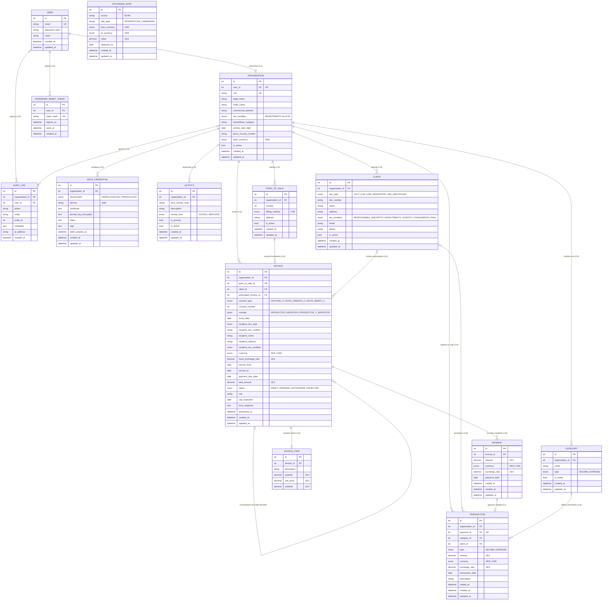
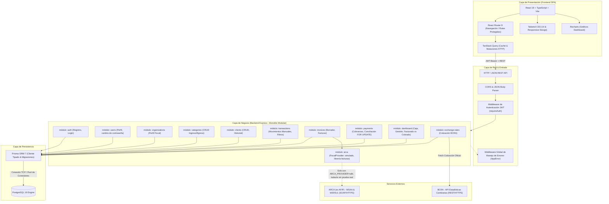
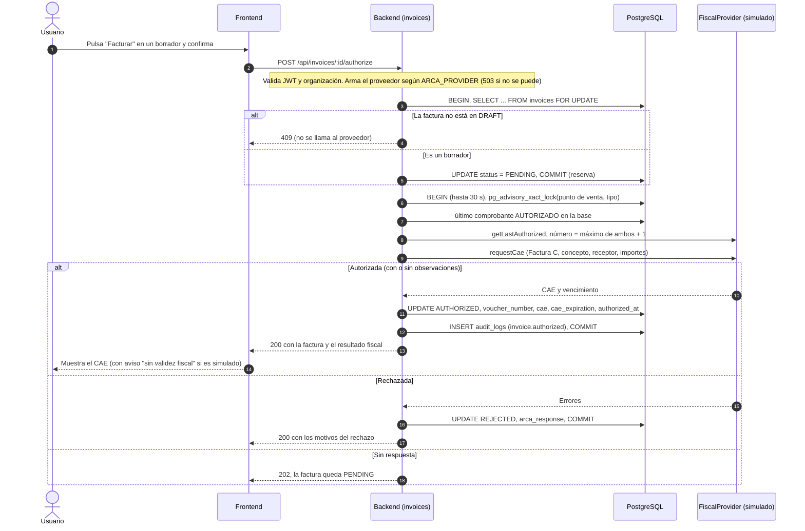
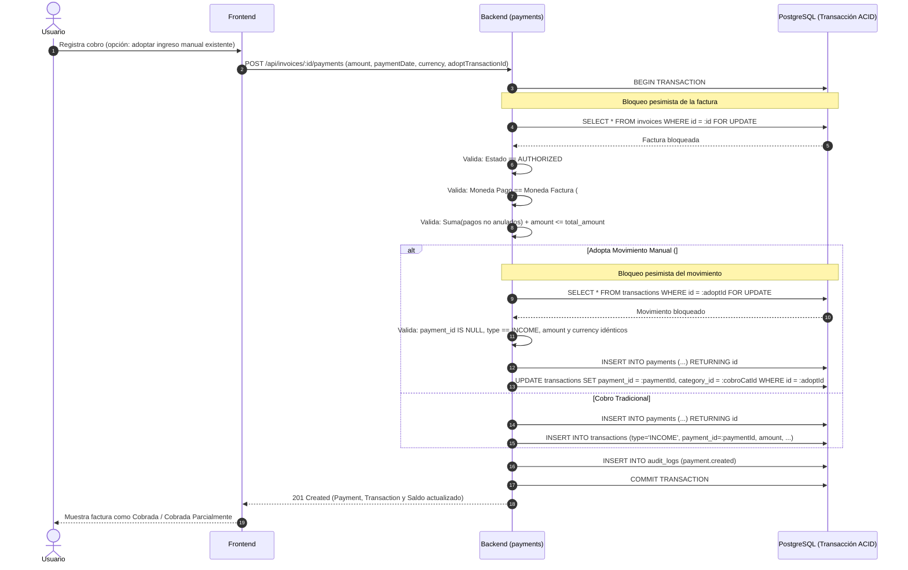

# Diagramas Finales y Arquitectura del Sistema

Este documento da cumplimiento al requerimiento **F10-4 (Issue #79: docs(der): armar los diagramas finales)** del proyecto. Reúne el Diagrama de Entidad-Relación (DER) con las tablas y columnas del esquema de Prisma (`backend/prisma/schema/`), el diagrama de arquitectura y los diagramas de secuencia de dos flujos críticos.

Qué parte está implementada:
- El DER coincide, tabla por tabla y columna por columna, con el esquema de Prisma. Lo que aparece en el esquema no siempre tiene pantalla o endpoint (por ejemplo, `PASSWORD_RESET_TOKEN`, `ACTIVITY` y `ARCA_CREDENTIAL` existen como tablas, pero todavía no hay recuperación de contraseña ni carga de actividades o credenciales).
- Los dos flujos de secuencia están implementados. El de facturar funciona con el proveedor fiscal simulado.

---

## 1. Diagrama de Entidad-Relación (DER) Final

El siguiente diagrama refleja la estructura de datos implementada en PostgreSQL a través de Prisma ORM (`backend/prisma/schema/*.prisma`).

### Características Clave del Modelo de Datos
1. **Multi-tenancy Fuerte:** Toda entidad de negocio está particionada lógicamente por `organization_id`. Las consultas filtran siempre por la organización del usuario autenticado vía JWT.
2. **Inmutabilidad y Snapshot Histórico:**
   - La tabla `Invoice` contiene campos de snapshot del receptor (`recipient_*`). Si el cliente asociado cambia de domicilio o razón social posteriormente, el comprobante fiscal permanece inalterado.
   - Todo movimiento en moneda extranjera (`USD`) guarda su tipo de cambio histórico en `exchange_rate`, asegurando que fluctuaciones cambiarias posteriores no alteren la caja histórica.
   - El snapshot del emisor (`Organization`) todavía no está: hoy la factura copia solo los datos del receptor (issue #95, pendiente).
3. **Desacoplamiento Fiscal y Comercial (Factura vs. Pago vs. Movimiento):**
   - Una `Invoice` autorizada representa un hecho fiscal y comercial, pero no mueve la caja por sí sola.
   - Cada `Payment` representa un cobro parcial o total y se vincula de forma exactamente 1:1 con un `Transaction` (`payment_id UNIQUE`).
   - El estado comercial (`PAID`, `PARTIALLY_PAID`, `PENDING`) es calculado dinámicamente (`total_amount - SUM(payments.amount)`).
4. **Baja Lógica y Trazabilidad:** Las tablas no destruyen datos históricos. Se utilizan banderas de baja lógica (`is_active` en catálogos y clientes) y marcas temporales de anulación (`voided_at` en pagos y movimientos).

---

## 2. Diagrama de Arquitectura Integral

El sistema está diseñado bajo el patrón **Monolito Modular** en el backend y una **Single Page Application (SPA)** en el frontend.

### Componentes de la Arquitectura
- **Frontend SPA (Vite + React 19):**
  - Renderizado completamente en cliente con TypeScript estricto.
  - El token JWT se guarda en memoria y se copia a `localStorage` para sobrevivir a una recarga. Esto lo expone a un ataque XSS; es una decisión de simplicidad para el alcance del TFI.
  - Un cliente HTTP propio (`apiFetch`) agrega el encabezado `Authorization: Bearer <token>` en cada petición.
  - Caché de datos y mutaciones con TanStack Query.
- **Backend (Node.js + Express):**
  - Separación rigurosa por módulos funcionales (`src/module/*`), cada uno compuesto por:
    - `*.schemas.ts`: Esquemas de validación de entrada con Zod.
    - `*.controller.ts`: Adaptadores HTTP que parsean parámetros y llaman al servicio.
    - `*.service.ts`: Lógica de dominio pura, reglas de negocio e interacción transaccional con Prisma.
    - `*.routes.ts`: Definición de endpoints y middlewares aplicables.
    - `*.test.ts`: Suite de pruebas unitarias y de integración del módulo con Vitest.
- **Base de Datos (PostgreSQL 16):**
  - Motor relacional que garantiza atomicidad, consistencia, aislamiento y durabilidad (ACID).
  - Bloqueo pesimista a nivel de fila (`SELECT ... FOR UPDATE`) en transacciones concurrentes de pagos y cobranzas.
  - Índices compuestos estratégicos para búsquedas por organización, fechas y clientes.
- **Integraciones Externas:**
  - **ARCA (WSAA + WSFEv1):** el sistema habla con ARCA a través de la interfaz `FiscalProvider` (`backend/src/module/arca/`). Hoy se elige por la variable `ARCA_PROVIDER`: `simulated` (cliente simulado, el que usa la demo), `sdk` (librería `facturas`, probada solo contra una simulación local y `FEDummy`) y `direct` (cliente propio, en el PR #141, sin mergear). La primera autenticación real contra homologación sigue pendiente (issue #138).
  - **BCRA:** consulta de la cotización oficial USD/ARS para sugerir el tipo de cambio de los movimientos (ver `docs/05-cotizacion.md`).

---

## 3. Diagramas de Secuencia de Flujos Críticos

### Flujo A: Facturar un borrador (con el proveedor simulado)

Lo que este flujo todavía **no** hace: reconciliar una factura que quedó `PENDING` (paso 3 de `docs/02-atomicidad-concurrencia.md`), reintentar una `REJECTED`, ni autenticarse con el ticket de WSAA (eso lo hace el proveedor real, aún sin probar).

---

### Flujo B: Cobro de Factura con Conciliación Atómica (Prevención de Doble Conteo)

---

## 4. Conclusiones Arquitectónicas

1. **Simplicidad Operativa:** La arquitectura de monolito modular permitió a tres desarrolladores trabajar concurrentemente en módulos independientes sin incurrir en la sobrecarga operativa, de red y de despliegue de microservicios.
2. **Robustez Transaccional:** La combinación de transacciones ACID en PostgreSQL con bloqueos pesimistas (`FOR UPDATE`) cubre los cobros y la reserva del borrador al facturar. Los tests que ejercitan la concurrencia real requieren PostgreSQL y no se probaron en el entorno donde se escribió esta versión.
3. **Desacople de ARCA:** La interfaz `FiscalProvider` permite cambiar entre el simulador, la librería y el cliente propio sin tocar el resto del sistema. Eso protege a la demo de la dependencia de ARCA, aunque no reemplaza la prueba real contra homologación.
