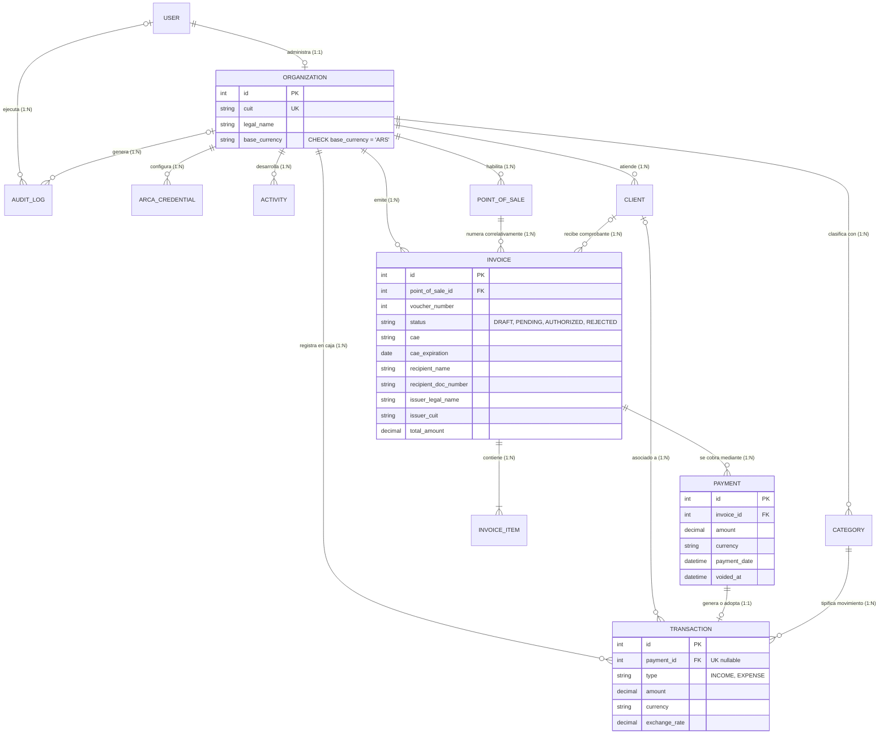

# Informe Final del Proyecto

**Universidad Tecnológica Nacional (UTN)**  
**Carrera:** Tecnicatura Universitaria en Programación  
**Asignatura:** Trabajo Final Integrador (TFI)  
**Proyecto:** Sistema web de gestión financiera y facturación electrónica para monotributistas  
**Equipo de Desarrollo:**  
- Rivero Albornoz, Juan Pablo
- Rios, Brian Emanuel
- Riveros Valgañón, Nahuel Nicolás

**Docente / Tutor de Tesis:** Lic. Oscar  
**Fecha:** Noviembre 2026  
**Estado:** Entrega Final (release [`entrega-final`](https://github.com/juanpiRiv/TFI-UTN-TUPAD/releases/tag/entrega-final))

### Enlaces de Acceso y Verificación Pública
- **Repositorio de Código:** [GitHub - juanpiRiv/TFI-UTN-TUPAD](https://github.com/juanpiRiv/TFI-UTN-TUPAD)
- **Frontend Desplegado en Producción:** [https://tfi-tupad-95d.pages.dev](https://tfi-tupad-95d.pages.dev)
- **Backend API Desplegada en Producción:** [https://tfi-utn-tupad.onrender.com](https://tfi-utn-tupad.onrender.com)
- **Video de Presentación:** [Ver el video en YouTube](https://youtu.be/l_pVbDO7ppU)

---

## 1. Resumen Ejecutivo

El presente Trabajo Final Integrador desarrolla una solución web orientada a monotributistas argentinos, unificando dos necesidades críticas que tradicionalmente se gestionan de manera fragmentada: la facturación fiscal electrónica ante la Agencia de Recaudación y Control Aduanero (ARCA, ex-AFIP) y el control financiero y operativo de caja (ingresos, egresos y resultado de gestión).

El núcleo conceptual del sistema parte de una premisa contable fundamental: **facturar, cobrar y registrar movimientos de caja representan tres hechos económicos independientes**. Emitir una factura formaliza un compromiso fiscal pero no incrementa la liquidez; el cobro (total o parcial) es el hecho que extingue el crédito y genera un ingreso de dinero en caja. 

El sistema se materializó como un monolito modular implementado en Node.js, Express, TypeScript, Prisma ORM y PostgreSQL 16 para el backend, y React 19, Vite, Tailwind CSS y TanStack Query para el frontend. Incluye una arquitectura desacoplada para la facturación electrónica mediante el patrón adaptador (`FiscalProvider`), permitiendo tanto la simulación determinística como la interacción real con los web services de homologación de ARCA (WSAA y WSFEv1), la emisión de comprobantes oficiales con código QR (RG 4892) y el resguardo de claves privadas con cifrado AES-256-GCM.

---

## 2. Problema, Justificación y Evidencia Empírica

### 2.1. Diagnóstico del Monotributista
El monotributista promedio no cuenta con formación contable ni dispone del presupuesto para costear sistemas ERP corporativos. Su operativa cotidiana se caracteriza por:
1. Emitir comprobantes fiscales ingresando manualmente al portal interactivo "Comprobantes en Línea" de ARCA, un proceso lento y propenso a errores.
2. Anotar cobros y pagos en planillas de cálculo (Excel/Google Sheets) o cuadernos físicos que rápidamente quedan desactualizados o son abandonados.
3. Desconocer en tiempo real su resultado económico de gestión, confundiendo facturación mensual con disponibilidad efectiva de dinero.
4. Gestionar cobros en partes (señales, anticipos) y transacciones bimonetarias (gastos o ingresos pactados en dólares estadounidenses) sin herramientas de conversión histórica.

### 2.2. Validación Empírica con Usuarios Reales
Para contrastar la hipótesis de diseño, se ejecutó un relevamiento empírico documentado en `docs/07-relevamiento.md` sobre tres monotributistas prestadores de servicios ajenos al equipo de desarrollo (un desarrollador de software contractor, un director audiovisual y publicitario, y un diseñador gráfico freelance).

**Hallazgos Confirmados (3 de 3 casos):**
- **Abandono del registro contable:** Todos manifestaron llevar planillas de Excel o herramientas personales desactualizadas debido al tedio de la doble carga (en ARCA y luego en la planilla).
- **Operaciones en moneda extranjera:** La totalidad de los encuestados reportó gastos periódicos en USD (suscripciones de software, insumos técnicos, servidores) o ingresos en dólares, requiriendo un seguimiento riguroso de la cotización histórica.
- **Cobros parciales:** Se constató el cobro en dos tramos (seña y saldo de entrega), respaldando la necesidad de admitir pagos parciales sin duplicar el ingreso en caja.

---

## 3. Objetivos y Alcance del Proyecto

### 3.1. Objetivo General
Diseñar, implementar y desplegar una plataforma web integral para monotributistas que automatice la facturación electrónica ante ARCA y simplifique la gestión de ingresos, egresos y cobranzas, garantizando consistencia financiera, inmutabilidad documental y concurrencia segura.

### 3.2. Alcance Implementado (Release P0)
1. **Seguridad y Acceso:** Autenticación basada en JWT (1 día de validez) y hashing de contraseñas mediante Argon2id. Aislamiento estricto de datos por organización (`multi-tenant` por software).
2. **Perfil Fiscal y Configuración:** Alta y configuración de la organización (CUIT, razón social, condición tributaria, domicilio comercial, inicio de actividades, IIBB). Registro de puntos de venta fiscales y actividades económicas de AFIP/ARCA, garantizando una única actividad primaria.
3. **Gestión Comercial de Clientes:** Alta, edición, búsqueda y baja lógica (`is_active = false`) para preservar la integridad referencial histórica.
4. **Caja y Movimientos Financieros:** Registro de ingresos y egresos en pesos (ARS) y dólares (USD). Consulta automatizada al BCRA para sugerir el tipo de cambio oficial del día, almacenando una copia histórica inmutable (`exchange_rate`).
5. **Ciclo de Facturación Electrónica:**
   - Creación de facturas en borrador (`DRAFT`) con uno o más ítems.
   - Cálculo estricto de subtotales y totales en el backend (prevención de manipulación en cliente).
   - Snapshot inmutable de datos del receptor (`recipient_*`) y del emisor (`issuer_*`) al dejar el estado de borrador.
   - Autorización fiscal ante ARCA (vía simulador para pruebas o vía `sdk` en homologación real).
   - Generación del Código de Autorización Electrónico (CAE), fecha de vencimiento y asignación del número correlativo oficial por punto de venta.
   - Vista e impresión del comprobante oficial con código QR fiscal estandarizado (RG 4892) y leyenda de prueba.
6. **Cobranzas y Conciliación:**
   - Registro de pagos parciales o totales sobre facturas autorizadas en la misma moneda (ARS).
   - Control atómico de sobrepago mediante bloqueos pesimistas (`SELECT ... FOR UPDATE`).
   - Mecanismo de Adopción de Movimientos (`adoptTransactionId`): permite vincular un cobro a un ingreso manual previo sin crear un movimiento duplicado en caja, resolviendo el doble cómputo en el dashboard.
7. **Dashboard y Reportes de Gestión:**
   - Métricas en tiempo real: Facturado, Cobrado, Saldo pendiente por cobrar.
   - Resultado de Caja (Ingresos percibidos − Egresos).
   - Resultado de Gestión (`facturado + ingresos manuales no conciliados − egresos`).
8. **Onboarding:** Tarjeta interactiva de primeros pasos en el inicio guiando la configuración del perfil, cliente, primer movimiento y primera factura.
9. **Infraestructura Cloud:** Despliegue productivo del backend en Render (con base de datos PostgreSQL 16) y del frontend en Cloudflare Pages, integrado mediante pipeline de integración continua (CI) en GitHub Actions.

### 3.3. Alcance Postergado a Fases Futuras (P1 / P2)
- **Consulta a la Central de Deudores del BCRA (#84):** Funcionalidad informativa que no afecta el circuito transaccional central.
- **Notificaciones por WhatsApp (#85):** Automatización secundaria condicionada a la existencia previa de comprobantes emitidos.
- **Comprobantes A y B (#86):** Comprobantes que exigen discriminación de alícuotas de IVA y Libro de IVA Digital, ajenos al régimen de Monotributo donde rige la Factura C.
- **Reportes descargables en PDF/Excel (#87):** El dashboard interactivo cubre las necesidades de consulta en pantalla para el MVP.
- **Recuperación de contraseña:** prevista en la propuesta, se posterga por la indicación docente de no ampliar el alcance en el cierre.
- **Límite de intentos de inicio de sesión e invalidación de sesiones al cambiar la contraseña (#128, #129):** mejoras de seguridad para una próxima versión.
- **Emisión en producción y reconciliación automática de facturas pendientes:** hoy la emisión se verificó en homologación y una factura pendiente se resuelve de forma manual.

---

## 4. Modelo de Dominio y Datos

El modelo de datos fue diseñado siguiendo las formas normales y garantizando la inmutabilidad de los hechos contables y fiscales ya perfeccionados.

### 4.1. Diagrama de Entidad-Relación (DER)

### 4.2. Inmutabilidad y Snapshots Fiscales
Un requisito esencial del sistema tributario es que una factura histórica nunca debe verse afectada por modificaciones posteriores en las entidades que le dieron origen:
- **Snapshot del Receptor:** Al autorizar, se copian en `Invoice` las columnas `recipient_name`, `recipient_doc_type`, `recipient_doc_number`, `recipient_address` y `recipient_tax_condition`. La edición o baja del cliente no altera comprobantes antiguos.
- **Snapshot del Emisor:** Respondiendo a la devolución docente (Issue #95 / PR #164), al momento de abandonar el estado de borrador (`DRAFT`), se copian en `Invoice` los campos `issuer_cuit`, `issuer_legal_name`, `issuer_trade_name`, `issuer_address`, `issuer_tax_condition`, `issuer_gross_income_number` e `issuer_activity_start_date`. Una restricción `CHECK` en PostgreSQL impide comprobantes no borradores con datos de emisor incompletos.
- **Inmutabilidad de la Cotización:** La tabla `transactions` almacena la cotización concreta del BCRA utilizada (`exchange_rate`). Las actualizaciones posteriores en la tabla de cotizaciones no modifican los registros históricos (RN-06).

---

## 5. Arquitectura del Software y Decisiones de Diseño

### 5.1. Monolito Modular
Se optó por una arquitectura de **monolito modular** en Node.js/Express estructurado por módulos de dominio (`auth`, `organizations`, `clients`, `transactions`, `invoices`, `payments`, `dashboard`, `exchange-rates`, `arca`).  
**Justificación:** Permite ejecutar operaciones transaccionales críticas (como registrar un cobro, insertar el pago, crear o adoptar el movimiento de caja y asentar el registro de auditoría) dentro de **una única transacción de base de datos (`prisma.$transaction`)**, garantizando consistencia ACID sin recurrir a la sobrecarga ni complejidad de transacciones distribuidas o patrones Saga.

### 5.2. Concurrencia y Control Transaccional
1. **Bloqueo Pesimista en Cobranzas:** Al registrar un pago (`POST /api/invoices/:id/payments`), el backend ejecuta un `SELECT ... FOR UPDATE` sobre la factura y sobre los pagos previos no anulados. Esto serializa las peticiones concurrentes y evita que dos cobros simultáneos superen el monto total facturado.
2. **Bloqueo Consultivo en Puntos de Venta:** Para asignar la numeración correlativa en ARCA sin colisiones entre instancias de ejecución, se emplea un bloqueo consultivo transaccional de PostgreSQL (`pg_advisory_xact_lock`) calculado a partir del ID del punto de venta y del tipo de comprobante.
3. **Mapeo de Moneda Base ARS:** Para el alcance P0 se fijó la restricción `CHECK (base_currency = 'ARS')` en la tabla de organizaciones. Los pagos deben coincidir de forma estricta en moneda con la factura (`payment.currency === invoice.currency`), impidiendo errores de conversión en el cálculo del saldo insoluto.

---

## 6. Integración con ARCA y Facturación Electrónica

### 6.1. Patrón Adaptador (`FiscalProvider`)
El acceso a los servicios de ARCA se aisló detrás de una interfaz desacoplada:
- **`ArcaSimulatedClient`:** Genera CAEs sintéticos válidos para desarrollo, demos y entornos de testing sin conectividad exterior, marcando de forma permanente la leyenda "Comprobante de prueba sin validez fiscal".
- **`ArcaSdkClient`:** Conector real basado en la librería `facturas@0.25.2`, interactuando con el Web Service de Autenticación y Autorización (WSAA) y el Web Service de Factura Electrónica versión 1 (WSFEv1).

### 6.2. Seguridad Criptográfica de Credenciales
- **Cifrado en Reposo:** Las claves privadas `.key` de los certificados de ARCA y los tickets de acceso WSAA se almacenan cifrados en PostgreSQL mediante **AES-256-GCM** utilizando la variable de entorno `ARCA_ENCRYPTION_KEY`. Nunca se exponen en texto plano ni viajan en respuestas JSON.
- **Asistente sin OpenSSL:** El frontend ofrece un asistente de 3 pasos que genera la clave privada y el CSR directamente en el servidor utilizando `@peculiar/x509`, de modo que el cliente únicamente debe pegar el CSR en el portal de ARCA y subir el `.crt` resultante.
- **Almacén Compartido de Tickets WSAA:** Para evitar el error `coe.alreadyAuthenticated` de ARCA (que deniega nuevos tickets si ya existe uno activo de 12 horas), el token y la firma se persisten cifrados en la tabla `arca_wsaa_tickets` con control de concurrencia entre instancias.

### 6.3. Emisión Real Verificada en Homologación
Durante el desarrollo se tramitó el certificado digital real en el portal WSASS de ARCA, logrando la emisión y autorización exitosa de Facturas C en el entorno de homologación:
- Emisiones probadas en los puntos de venta 1 y 2 con numeración correlativa sin saltos.
- Comprobantes consultados y verificados con `FECompConsultar`, obteniendo `Resultado A` y CAE genuino.
- Generación del código QR conforme a las especificaciones de la RG 4892 de AFIP/ARCA, con URL verificable que codifica CUIT, punto de venta, tipo de comprobante, número, importe, moneda, cotización y CAE.

---

## 7. Despliegue e Infraestructura Cloud

La solución se encuentra completamente operativa en entornos de nube pública:
- **Backend API:** Desplegado en **Render** (`https://tfi-utn-tupad.onrender.com`) ejecutando el contenedor Docker oficial con Node.js 22 Slim. Se conecta a una instancia gestionada de PostgreSQL 16.
- **Frontend SPA:** Desplegado en **Cloudflare Pages** (`https://tfi-tupad-95d.pages.dev`), consumiendo los endpoints de Render mediante CORS restringido al dominio de producción.
- **Pipeline de Integración Continua (CI):** Implementado en **GitHub Actions**, ejecutando en cada Pull Request validaciones estáticas de TypeScript (`tsc -b`), linter (`eslint`), build de producción de ambos paquetes y la suite completa de pruebas unitarias y de integración sobre un contenedor de PostgreSQL real.

---

## 8. Matriz de Reglas de Negocio Críticas vs Pruebas

| Regla de Negocio | Descripción | Implementación Técnica | Evidencia de Test Automatizado |
| :--- | :--- | :--- | :--- |
| **RN-01** | Movimiento atado a organización | FK obligatoria `organization_id` | `transactions.test.ts` |
| **RN-02** | Tipo `INCOME` o `EXPENSE` | Enum `TransactionType` en Prisma | `transactions.test.ts` |
| **RN-03** | Importes financieros estrictamente positivos | Restricciones `CHECK (amount > 0)` en DB | `transactions.test.ts`, `payments.test.ts` |
| **RN-04** | Moneda obligatoria | Columna Enum `Currency` not null | `transactions.test.ts` |
| **RN-05** | Cotización requerida en moneda secundaria | `CHECK (currency = 'ARS' OR exchange_rate IS NOT NULL)` | `transactions.test.ts` |
| **RN-06** | Inmutabilidad de cotización histórica | Copia de cotización en `transactions.exchange_rate` | `transactions-rn06.integration.test.ts` |
| **RN-07** | Al menos un ítem por factura | Validación en servicio `invoices.service.ts` | `invoices-create.test.ts` |
| **RN-08 / 09** | CAE exclusivo de facturas autorizadas | `CHECK (status = 'AUTHORIZED' <-> cae IS NOT NULL)` | `invoices-authorize.test.ts` |
| **RN-10** | Facturado y cobrado independientes | Tablas `invoices` y `payments` separadas | `invoice-flow.integration.test.ts` |
| **RN-11** | Imposibilidad de borrado físico de factura fiscal | `ON DELETE RESTRICT` en claves foráneas | `invoices.test.ts` |
| **RN-12** | Baja lógica de clientes | Columna `is_active = false` en `clients` | `clients.test.ts` |
| **RN-13** | Registro temporal de consulta al BCRA | Timestamp `created_at` en `exchange_rates` | `exchange-rates.test.ts` |
| **RN-14** | Credenciales fuera del repositorio | Cifrado AES-256-GCM y variables de entorno | `key-rotation.test.ts`, `security.test.ts` |
| **Dev-2 (1)** | Moneda del pago idéntica a la factura | Validación 422 en `payments.service.ts` | `payments.test.ts` |
| **Dev-2 (2)** | No duplicación ingreso manual vs factura | Adopción `adoptTransactionId` con `FOR UPDATE` | `payments.test.ts`, `dashboard.service.ts` |
| **Dev-2 (3)** | Snapshot emisor al autorizar | Columnas `issuer_*` copiadas desde Organization | `invoices-authorize.test.ts` |
| **Dev-2 (4)** | Moneda base fija en ARS para P0 | `CHECK (base_currency = 'ARS')` en DB | `organizations.test.ts` |
| **Dev-2 (5)** | Una sola actividad primaria | Índice único parcial `WHERE is_primary = true` | `activities.test.ts` |

---

## 9. Resultados de Testing y Verificación

- **Backend API:** **764 pruebas** con Vitest y Supertest, incluidas las de integración y concurrencia contra PostgreSQL real, que corren en GitHub Actions en cada pull request.
- **Verificación de Tipos y Compilación:** `tsc` en frontend y backend termina sin errores.
- **Corte de Métricas:** 16 de noviembre de 2026, sobre la versión publicada como release `entrega-final`.

---

## 10. Limitaciones Conocidas

1. **Latencia de Despertar en Render:** La capa gratuita de Render entra en suspensión tras 15 minutos de inactividad, introduciendo una demora aproximada de 30 a 40 segundos en la primera petición HTTP.
2. **Alcance Tributario Restringido:** El sistema se encuentra optimizado para el régimen simplificado de Monotributo (Factura C). La emisión de Facturas A y B requiere soporte de alícuotas discriminadas y percepciones tributarias que no forman parte del alcance de este proyecto.

---

## 11. Conclusiones

El desarrollo del presente Trabajo Final Integrador permitió arribar a las siguientes conclusiones técnicas y académicas:
1. **La solidez conceptual temprana ahorra retrabajo:** Separar conceptual y relacionalmente Facturas, Pagos y Transacciones evitó refactorizaciones estructurales a medida que se incorporaron cobros parciales y mecanismos de adopción.
2. **La integridad financiera debe residir en el motor de base de datos:** El uso de restricciones `CHECK`, índices únicos parciales y bloqueos pesimistas (`SELECT ... FOR UPDATE`) garantiza consistencia ante peticiones concurrentes, independientemente de la lógica de aplicación.
3. **Resiliencia ante servicios estatales de alta incertidumbre:** La implementación de una interfaz desacoplada (`FiscalProvider`) permitió avanzar de manera sostenida con un simulador mientras se sorteaban las complejidades administrativas y técnicas de los certificados de ARCA, culminando en una integración homologada real exitosa.

---

## Anexo: Respuesta a las Devoluciones Docentes

### Primera Entrega
| Observación Docente | Resolución del Equipo | Estado |
| :--- | :--- | :--- |
| Formato y actualización de la propuesta | Migración a formato estructurado en Markdown (`docs/01-propuesta.md`). | **Hecho** |
| Factura, pago y movimiento independientes | Tablas separadas `Invoice`, `Payment` y `Transaction`. | **Hecho** |
| DER y diccionario de datos formal | DER actualizado y diccionario en `docs/03-modelo-de-datos.md`. | **Hecho** |
| Atomicidad y concurrencia | Bloqueos `FOR UPDATE` en cobros y consultivos en puntos de venta. | **Hecho** |
| Dependencia de ARCA | Creación de `FiscalProvider` con simulación y plan de contingencia. | **Hecho** |
| Multimoneda y cotizaciones | Integración con API del BCRA y registro inmutable en movimientos. | **Hecho** |

### Segunda Entrega
| Observación Docente | Resolución del Equipo | Estado |
| :--- | :--- | :--- |
| Snapshot del emisor en la factura | Se agregaron columnas `issuer_*` en `Invoice` copiadas al autorizar. | **Hecho** |
| Moneda base fija en ARS para P0 | Restricción `CHECK (base_currency = 'ARS')` en base de datos. | **Hecho** |
| Coincidencia de moneda Payment e Invoice | Validación en servicio con código HTTP 422 si las monedas difieren. | **Hecho** |
| Evitar doble conteo en Dashboard | Mecanismo de adopción `adoptTransactionId` y fórmula matemática en dashboard. | **Hecho** |
| Una sola actividad primaria por organización | Índice único parcial `WHERE is_primary = true` en tabla `activities`. | **Hecho** |

### Tercera Entrega
| Observación Docente | Resolución del Equipo | Estado |
| :--- | :--- | :--- |
| Evaluación técnica de alternativas ARCA | Análisis comparativo documentado; adopción de librería para WSAA/WSFEv1. | **Hecho** |
| Pruebas contra homologación | Emisión real de Factura C en puntos de venta 1 y 2 con CAE oficial y QR. | **Hecho** |
| Recorrido vertical de punta a punta | Eliminación de mocks en producción; flujo completo verificado en Render y Cloudflare. | **Hecho** |
| Relevamiento empírico | Ejecución de 3 entrevistas a monotributistas reales y conclusiones en `docs/07`. | **Hecho** |
